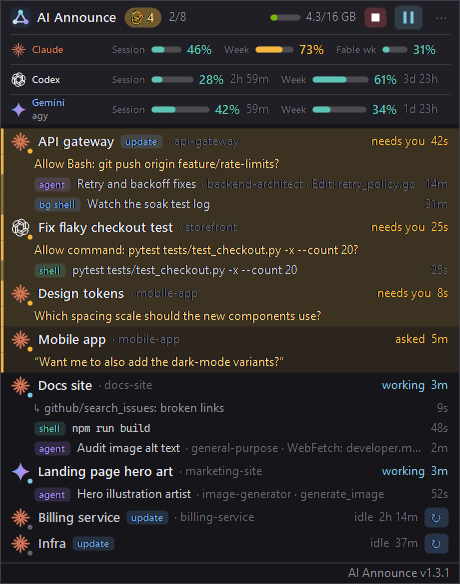

# AI Announce

[](https://github.com/C-Squared-Solutions-LLC/AIAnnounce/actions/workflows/build.yml)
[](LICENSE)

Always-on-top Windows overlay listing every running Claude Code, Codex and agy (Antigravity CLI) session: what each one is doing, which agents and shells it has going, and a ✋ when one needs you. It shows on every virtual desktop. GPU memory sits in the header.

Windows 10/11 only. Unofficial; not affiliated with Anthropic, OpenAI or Google. It watches the CLIs you already run (`claude`, `codex`, `agy`), so install and sign in to those yourself.

**[Download the installer](https://github.com/C-Squared-Solutions-LLC/AIAnnounce/releases/latest/download/AIAnnounce-win-x64.msi)** and run it. No admin needed. Other options are under [Install](#install).



## Install

1. Download **[AIAnnounce-win-x64.msi](https://github.com/C-Squared-Solutions-LLC/AIAnnounce/releases/latest/download/AIAnnounce-win-x64.msi)** from the [latest release](https://github.com/C-Squared-Solutions-LLC/AIAnnounce/releases/latest).
2. Run it. It installs for your Windows account only, with no admin prompt, adds AI Announce to the Start menu, and starts the overlay.
3. If Windows says it protected your PC, click **More info → Run anyway**. The installer isn't code-signed yet.

A newer MSI upgrades it in place. Uninstall from Settings → Apps.

Rather not install? The latest release also has:

- [`AIAnnounce-win-x64-self-contained.zip`](https://github.com/C-Squared-Solutions-LLC/AIAnnounce/releases/latest/download/AIAnnounce-win-x64-self-contained.zip): the same program as a portable exe. No .NET install needed.
- [`AIAnnounce-win-x64-framework-dependent.zip`](https://github.com/C-Squared-Solutions-LLC/AIAnnounce/releases/latest/download/AIAnnounce-win-x64-framework-dependent.zip): much smaller, needs the [.NET 8 Desktop Runtime](https://dotnet.microsoft.com/download/dotnet/8.0) or newer.

Unzip somewhere permanent before pinning it or turning on Start with Windows: both point at the exe where it sits. [`SHA256SUMS.txt`](https://github.com/C-Squared-Solutions-LLC/AIAnnounce/releases/latest/download/SHA256SUMS.txt) lists checksums for all three files.

## Privacy

- Session monitoring reads files the CLIs already write on your machine. Nothing about your sessions leaves it.
- **Plan usage** reads each CLI's saved login and asks that provider for your quota numbers: `api.anthropic.com` for Claude, `chatgpt.com` for Codex, `daily-cloudcode-pa.googleapis.com` for Gemini through agy. Each token goes to its own provider only and is never refreshed, logged or saved by this app. Switch **Plan usage** off in the `⋯` menu and none of that happens.
- There's no telemetry and no other network traffic.
- Pause and Play type a short prompt into each session (see below). That's a real turn, so it uses tokens. Nothing else in the app does.

## What it shows

- **Sessions.** One row per live `claude.exe`, Codex TUI and `agy`: name, project, state (`working`, `idle`, `needs you`, `asked`, `paused`), time in that state. Each row has its provider icon and a small activity dot. agy sessions use the Gemini sparkle, reflecting their Gemini-only use. Sessions waiting on you sort to the top.
- **Agents.** Each running subagent with its type, description, and the tool it's on right now.
- **Shells.** Foreground Bash/PowerShell commands, background shells (`run_in_background`, or a command auto-backgrounded after its timeout), long-running watcher loops.
- **✋ Needs you.** Amber row, pulsing hand, and a toast when a session is blocked on you: permission prompt (shows the command or file), `AskUserQuestion` (shows the question), plan approval, MCP input. Also when Claude ended its last reply with a question.
- **✔ Finished.** A toast when a working session settles idle, so you know its turn is done: "✔ Docs site finished", with how long it worked. Click it to jump to that terminal. The toast is silent by default; turn on **Play a sound** under **When a session finishes** for a short two-note chime that's distinct from the needs-you sound. Brief wake-ups don't count, a turn that ends on a question gets the needs-you alert instead, and sessions you paused or stopped from the overlay aren't announced.
- **VRAM.** Used/total for the first NVIDIA GPU via NVML, with a bar. Hover the header for load %.
- **Plan usage.** Separate Claude, Codex, and Gemini (agy) rows show session and weekly quotas **used**, with reset countdowns. agy usage comes exclusively from Gemini model quotas; Claude/GPT, non-Gemini, and shared account totals are excluded. Claude's row adds a model-specific weekly limit, such as Fable's, when your plan has one: Session, Week and Fable wk side by side on 5-hour plans, Week and Fable wk on plans without a 5-hour window. Bars turn yellow at 70% and red at 90%. Hover for the source, freshness, exact reset times, and any further model limits; click to refresh. A dash means the window is not reported or its data is unavailable. Weekly-only Codex plans do not invent a session limit. Passed resets are marked until fresh data arrives.
- **Taskbar button.** A pinnable, provider-neutral network icon, also used in the tray and header. Its progress bar is the usage limit closest to running out, it gets a ✋ badge while a session needs you, and hovering it shows the overlay as the thumbnail. Clicking it shows or hides the overlay.

- **Update tag and ↻ restart.** Sessions running an older Claude Code build than the newest one installed get a blue `update` tag. When such a session is idle and was started from a shell (pwsh, Windows PowerShell, cmd, bash), a ↻ button sits on the right of its row. It exits Claude and types `claude --resume <session id>` into that same shell. The conversation picks up where it was, on the new build, in the same tab; your other launch flags are kept. Right-click any idle session for **Restart session**, or use **Restart idle sessions on old builds** in the `⋯` menu to cycle them all (staggered 1.5 s apart).
- **Pause / Play.** Pause interrupts currently working sessions (including sessions with active agents), sends an instruction to stop and wait (a short prompt, so it costs a turn), then turns into Play. While AI Announce runs, it interrupts tracked sessions that start working again. Play continues only the sessions this button paused; previously idle sessions stay idle. The paused list survives an overlay restart. Pending approvals are never answered automatically: resolve one in its terminal and click Play again. Unreachable sessions stay in the list for retry. Also available in the overlay and tray menus.
- **■ Emergency stop.** The red square in the header appears while anything is working. Click it, then click **Stop N?** within 3 seconds. Every working session gets Esc, exactly as if you'd pressed it in that terminal. Sessions with background agents also get `ctrl+x ctrl+k` twice (Claude's stop-all-agents keys), and any stopped session that wakes up again in the next 10 seconds gets one more Esc. Also in the `⋯` and tray menus.

Click a session to jump to it. The overlay finds the exact Windows Terminal window hosting that session and selects its tab.

### How restart and stop type into a session

Keys go straight into the session's console input buffer (`AttachConsole` + `WriteConsoleInput`). That's the same thing as typing in that terminal, without focusing or even seeing it. Checked against a live 2.1.316 session:

- Esc stops a running turn within about a second. An interrupted prompt goes back into the input box, same as by hand.
- Exit is `ctrl+c` (empties a half-typed draft), then `/exit`, then Enter. `ctrl+l` is wired to clear-screen rather than clear-input, and `ctrl+d` didn't exit.
- The stop-agents chord is only sent when a session actually has agents running. With none running it "disarms artifact auto-replies", and that notice arrives as a message that starts a fresh turn.
- A restart is skipped if the session stopped being idle between your click and the keys, and abandoned if Claude hasn't exited 20 seconds later.

Background shells (`run_in_background` commands, dev servers, watchers) keep running through an emergency stop, as they would if you pressed Esc yourself.

Pause is cooperative: it interrupts the turn and asks the agent to stop its agents and wait. Claude also receives its stop-all-agents shortcut when agents are present. Play continues the existing conversation; it does not relaunch the CLI or restore an agent process. Independent background shells are not suspended by Windows and can continue until their owning agent stops them. While the overlay is closed, it cannot re-interrupt a session that wakes itself up. Paused targets are stored in `%LOCALAPPDATA%\AIAnnounce\paused-sessions.json`; creation time and conversation ID prevent typing into a replacement process or a different conversation.

### Codex and agy

Both get the same rows, ✋ alerts, toasts and click-to-jump as Claude sessions. Restart (↻) and the `update` tag stay Claude-only. The emergency stop sends them Esc, which interrupts a turn in both, and skips Claude's stop-agents chord.

- **Codex.** Each terminal `codex` is a row. `codex exec` runs aren't: they're other agents calling Codex, and they already show as a shell under the session that ran them. Running commands show as shell rows. ✋ covers command, edit, permission and network approvals plus questions Codex asks with its question tool, and `asked` works off the reply a turn ended on.
- **agy.** Each interactive `agy` is a row (`agy --print` runs are skipped, same reason). Subagents it starts show as agent rows while they work. ✋ covers tool approvals, `ask_question`, and a subagent stuck waiting on you.

agy leaves its shell's title on the tab, so there's no tab name to match. Clicking an agy row retitles that console for a moment, selects the tab showing the new title, and puts the old title back. A renamed tab ignores console titles, so then only the window comes forward.

### Pinning it

Windows doesn't let apps pin themselves; the old pin verb is gone and the modern API is restricted to apps Microsoft whitelists. Pinning takes one click from you: with the app running, right-click its AI Announce button on the taskbar and pick **Pin to taskbar**. After that the pin starts the app if it isn't running and toggles the overlay if it is.

## How it knows

Session monitoring reads files the CLIs already write. Gemini quotas can also use agy's optional, documented status-line feed:

| What | Source |
|---|---|
| live sessions; busy / idle / waiting and why | `~/.claude/sessions/<pid>.json` (Claude rewrites `status` and `waitingFor` on every change) |
| question text, permission target, agent launches, background tasks, AI tab title | tail of `~/.claude/projects/<project>/<session>.jsonl` |
| agent progress | `<session>/subagents/agent-*.meta.json` and `agent-*.jsonl` |
| shells | `bash.exe` / `pwsh` children of each `claude.exe` (Claude's tool shells carry a recognizable command line) |
| Claude plan usage | `GET https://api.anthropic.com/api/oauth/usage` every 3 minutes, falling back to `cachedUsageUtilization` in `~/.claude.json` |
| Codex plan usage | Authenticated Codex account usage, falling back to the latest `token_count.rate_limits` in local rollouts, checked every 15 seconds |
| Gemini plan usage through agy | Optional agy status-line quota feed, or a read-only OAuth request to `https://daily-cloudcode-pa.googleapis.com/v1internal:retrieveUserQuotaSummary`; only Gemini buckets/groups are displayed |
| Codex sessions | `codex.exe` processes that aren't a subcommand like `exec` or `app-server` |
| which Codex thread a terminal shows | its console title, `<thread name> \| <project>`, matched against `~/.codex/session_index.jsonl` (`codex resume <id>` and the rollout opened at startup cover a thread with no name yet) |
| Codex turns, commands, questions, last reply | `~/.codex/sessions/YYYY/MM/DD/rollout-*-<thread id>.jsonl`, followed from the start |
| Codex approvals | the bottom of the TUI's screen, read only once an open turn has written nothing for a few seconds: approvals never reach the rollout |
| agy sessions | `agy.exe` processes without `--print` |
| which conversation an agy shows | `~/.gemini/antigravity-cli/log/cli-<start time>.log`: its first line names the pid, later lines each conversation it opens |
| agy steps, approvals, questions, subagents | `~/.gemini/antigravity-cli/conversations/<id>.db`, read-only through the SQLite that ships with Windows (`winsqlite3.dll`); each step has a status: running, waiting on you, done |
| agy titles | `~/.gemini/antigravity-cli/annotations/<id>.pbtxt` |

Liveness is checked against the process creation time Claude records, so a recycled PID never shows up as a session. Codex and agy rows are their processes, checked the same way.

Codex runs its agent in a shared `app-server` daemon on newer builds, so commands are children of the daemon, not of the terminal. That's why Codex shells come from the rollout, not from the process tree.

Plan usage needs your Claude login, so the app reads the OAuth access token from `~/.claude/.credentials.json`. It's sent to `api.anthropic.com` and nowhere else, never written to the log, and never refreshed by this app: refreshing rotates the token underneath your running Claude sessions. If the token has expired, the overlay shows Claude Code's cached numbers until one of your sessions refreshes it.

Codex and agy also own their authentication: this app never refreshes or rotates their tokens. Codex tokens go only to `chatgpt.com`; agy tokens go only to `daily-cloudcode-pa.googleapis.com`, the host used by Antigravity CLI (the plain `cloudcode-pa.googleapis.com` route can return HTTP 403 for these requests). Network refreshes run every three minutes. One unavailable provider does not hide the others. agy credentials must be accessible to the Windows user running the overlay; a restricted or different logon session can show unavailable data.

These are internal formats of all three CLIs, and an update can change them. Checked against Claude Code 2.1.316, Codex 0.166.0 and agy 1.4.12. `--dump` prints exactly what the app parses, so start there if something looks off.

## Using it

Launching it again while it runs just brings the overlay back if it was hidden.

- Drag anywhere to move; it snaps to screen edges. Double-click the header to collapse it to one line.
- Right-click, or the `⋯` button: hide idle sessions, notifications and sounds (separately for **When a session needs you** and **When a session finishes**), opacity, taskbar button, start with Windows, plan usage, refresh usage, reset position. Turning a sound on plays it once.
- Right-click a session: go to terminal, open folder, copy session ID, dismiss its ✋, restart it.
- Tray icon: left-click toggles the overlay. The menu lists sessions that need you.

Settings and a small log live in `%LOCALAPPDATA%\AIAnnounce`. Uninstalling leaves that folder in place; delete it to drop your settings too. Uninstall does remove the Start with Windows entry and puts back agy's previous status line if you connected Gemini usage, as long as both point at the copy being removed.

For unavailable quotas, open **Usage details...** from the overlay or tray menu, click **Refresh**, then **Copy details**. The report distinguishes Windows credential errors, missing or expired agy tokens, network failures, HTTP errors and unrecognized Gemini quota responses. It contains quota data and diagnostic messages, never tokens or server response bodies. The running overlay also saves it to `%LOCALAPPDATA%\AIAnnounce\usage-status.txt`.

If Google's direct quota endpoint rejects the app, click **Connect Gemini usage** in Usage details. This configures agy's [documented status-line command](https://antigravity.google/docs/cli/statusline), preserving its built-in display with `stack_with_default`. To activate it immediately in an existing agy session, paste the displayed `/statusline ...` command into agy, then run `/usage`. Reopening agy also loads the setting. The helper receives agy's quota data and saves only parsed Gemini limits in `%LOCALAPPDATA%\AIAnnounce\gemini-usage.json`. The overlay reads this every 15 seconds without credential access or additional Google requests. Data older than three minutes is labeled cached. Other model quotas, account details and conversation metadata are discarded. Existing custom status-line commands are left unchanged, and settings are backed up to `settings.json.before-aiannounce` before connection. Use `/statusline delete` in agy to disconnect. A separate status file records only when the helper ran, a result code and the quota bucket count, so diagnostics can distinguish an unstarted command from missing quota data.

Claude rate limits are reported as HTTP 429, with the next retry time. Last known limits and retry timing are saved locally so restarting the overlay preserves cached usage and respects the cooldown.

`AIAnnounce.exe --usage` attaches to the calling console when needed, or opens the usage details window if no console is available. `AIAnnounce.exe --usage-report report.txt` also writes the report to the named file. When scripting in PowerShell, pipe `--usage` to `Out-Host` to wait for the GUI executable's output.

Overlay and tray dropdowns, including nested menus such as Opacity, keep themselves above other topmost windows while open.

Diagnostics print to the console you run them from, or to a pipe:

```
AIAnnounce.exe --dump                  parsed sessions, agents, shells, GPU
AIAnnounce.exe --usage                 all providers' quotas and availability (no credentials)
AIAnnounce.exe --tabs                  Windows Terminal tabs as UI Automation sees them
AIAnnounce.exe --focus <pid>           jump to that session's tab
AIAnnounce.exe --render out.png [--demo] [--paused]   paint the overlay to a PNG
AIAnnounce.exe --write-icon assets/AIAnnounce.ico     rebuild the neutral application icon
AIAnnounce.exe --stop <pid>            emergency-stop one session
AIAnnounce.exe --restart <pid>         exit and resume one idle session
AIAnnounce.exe --screen <pid>          print what that session's console shows, its title, and any Codex approval prompt on it (read-only)
AIAnnounce.exe --type <pid> "text{enter}{esc}{ctrl+c}{pause:300}"   raw key injection
AIAnnounce.exe --bench                 time one poll and one process snapshot
```

A poll costs ~2 ms. The expensive part is the process snapshot (~17 ms with ~900 processes), so new shells are picked up every 2 s while a session is busy and every 6 s otherwise. In practice the overlay sits around 2% of one core and ~60 MB private memory.

## Notes

- Windows holds back toasts while a fullscreen app or Do Not Disturb is active; they land silently in the Notification Center. The overlay still flags the session. Turn on **Play a sound** for an audible cue.
- Tab switching is Windows Terminal specific. Other hosts (VS Code, conhost) get their window raised.
- `CLAUDE_CONFIG_DIR` is honored; `--claude-dir <path>` overrides it.

## Build from source

Needs the .NET 8 SDK or newer and nothing else; the installer's WiX toolset comes from NuGet.

```powershell
.\build.ps1            # -> dist\AIAnnounce.exe (framework-dependent; close the app first)
.\build.ps1 -Release   # -> artifacts\: the MSI and both zips, as CI builds them
```

A release is cut by pushing a version tag: `git tag v1.2.7 && git push origin v1.2.7`. Tags must be `vX.Y.Z`, the only form an MSI version takes. CI runs the checks, builds, and attaches the MSI and zips to the release.

## Verification

`dotnet run --project tests/AIAnnounce.Tests.csproj -c Release` checks quota parsing, pause/resume and uninstall cleanup without sending input to real sessions. CI runs it on every push. `--render --demo` covers provider icons, quotas, alerts, and controls; add `--paused` to preview Play.

Protocol references: [Codex rate-limit fields](https://learn.chatgpt.com/docs/app-server) and [agy quota/status-line schema](https://antigravity.google/docs/cli/statusline). Authenticated endpoints and local client formats are internal integrations and may change with client updates.

## Trademarks

Claude, Codex, OpenAI, Gemini and Antigravity are trademarks of their owners (Anthropic, OpenAI and Google). They're named here, and their icons appear in the overlay, only to show which tool a session belongs to. None of them endorses this project.

## License

[MIT](LICENSE)
